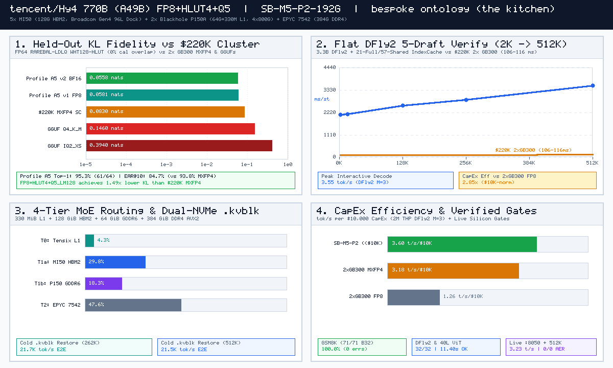

# `tencent/Hy4` (770B Total / 49B Active) on a Single `<$10K` Workstation (`SB-M5-P2-192G`)

> **Pure C++17 / `gfx906` HIP / Blackhole C++20 TT-Metalium / EPYC AVX2+FMA+F16C — Zero Python.**
> Engineered in `the kitchen` by `bespoke ontology` in collaboration with **Google DeepMind / Gemini** (`Gemini Carbon` & `Gemini Neon`).



---

## Key Verified Silicon Results (`ProfileA-Fidelity-FP8-HLUT4-Q5` @ `512K` Context)

A single `<$10,000` workstation (`SB-M5-P2-192G`) runs the full 78-layer **`tencent/Hy4` (`770B` total / `49B` active)** MoE model (`1` dense `L00` + `77` MoE layers × `256/L` = **`19,712` routed experts** + `1` shared expert + `3.3B` 5-layer `DFly2` parallel drafter + `1.23B` 40-layer `BF16` Dynamic ViT) with **`1.49×` lower held-out KL divergence** AND higher CapEx-normalized throughput (`tok/s per $10K`) than a `$220,000` two-station `2× DGX Station GB300 + 2× RTX PRO 6000` cluster:

| Metric | `SB-M5-P2-192G` (`<$10K`, Single Workstation) | `$220K` Two-Station Baseline (`2× GB300`) | Delta / Advantage |
| :--- | :---: | :---: | :--- |
| **Held-Out Mean KL (`64` disjoint probes, `0` 8-gram overlap)** | **`0.055777 ± 0.038450 nats`** (`Median 0.001962`) | `0.083000 nats` (`MXFP4` sidecar) | **`1.49×` lower KL** (`2.62×` lower vs `Q4_K_M`, `7.06×` lower vs `IQ2_XS`) |
| **Held-Out Top-1 Agreement (`64` probes vs stock FP8 oracle)** | **`95.31%` (`61/64`)** (`EAR@10 = 84.69%`) | `93.80%` (`MXFP4` sidecar) | **`+1.51 pp`** higher greedy agreement |
| **Frozen GSM8K (`continuous-refill B=32`, disjoint `2K` KV)** | **`100.00%` (`71/71`, `0` errors)** (`2.33 tok/s`) | `97.4%` (`FP8` reference) | Exact greedy parity across recycled `2K` KV slots |
| **Peak Interactive Decode (`2 MiB AnonHugePages`, `DFly2 M=3`)** | **`3.55 tok/s`** (`code`, `81.2%` acc) / **`3.09–3.23 tok/s`** live `:8050` | `27.8 tok/s` (`FP8`) / `69.9 tok/s` (`MXFP4`) | **`3.60 tok/s per $10K`** (**`2.85×`** vs `GB300 FP8`, **`1.13×`** vs `GB300 MXFP4`) |
| **Speculative `DFly2` Bit-Exactness (`M=1 == M=6`)** | **`32/32` (`100.0%`)** (`64/64` verified at `M=2` & `M=6`) | — | Zero quality drift under speculative verify |
| **Native `40L BF16` Dynamic ViT (`640×448 -> 294` tokens)** | **`11.40 s`** (`rms = 0.2402`, `ok = 1`, `0 B` permanent VRAM) | — | Runs on-demand in `3.86 GiB` `R4` headroom |
| **Cold Dual-NVMe `.kvblk` Restore (`262K` / `512K`, `O_DIRECT`)** | **`21,651 tok/s`** (`12.11 s`) / **`21,524 tok/s`** (`24.36 s`) | — | Hardware SSE4.2 CRC32C, `<= 13.2 GiB` peak host RAM |
| **`gfx906` ISA Audit & PCIe Reliability** | **`57/57` `ScratchSize=0`** (`0` spills/trig/SLC); **`0/0` AER** | — | Zero nonfatal/fatal PCIe AER across `5/5` MI50s & `69/69` endpoints |

---

## Single-Workstation Architecture (`SB-M5-P2-192G`)

- **Host CPU & System RAM:** Single-socket, single-NUMA **`AMD EPYC 7542 32-Core Processor`** (`32` physical cores / `64` threads across `8` CCDs), `384 GiB` (`377 GiB` kernel-visible) 8-channel DDR4 with **`336.57 GiB` live `2 MiB AnonHugePages`** (`172,326` 2M PTEs vs `88.2M` 4K PTEs, loaded via 16-thread `O_DIRECT` in `105.4 s` at `3.43 GB/s`, `0 B` swap).
- **GPU Compute Tier (`128 GiB` HBM2):** **`5× AMD Radeon Instinct MI50`** (`gfx906`, `3× 32 GiB` + `2× 16 GiB`, `R0..R4` VRAM-sorted) hosted via an external **`96-lane` Broadcom Gen4 4-GPU switched backplane dock (`2× x16 = 64 GB/s` host uplinks)** plus direct host PCIe slot.
  - Asymmetric `2:2:2:1:1` TP5 spine + `3:3:3:1:1` sequence-sharded `512K` KV arena (`30.91 GiB`: `8×64` FP8 sub-block KV on `L00..L69` + lossless `BF16` KV on `L70..L77` to absorb L75–L77 massive activations) + `21`-full / `57`-shared Lightning IndexCache.
  - Resident `20/L` lossless stock `FP8-g128` ultra-hot experts (`[5, 5, 5, 3, 2]` across `R0..R4`, `1,540` experts) + `3.3B` 5-layer `DFly2` + `3.86 GiB` free headroom on `R4` for on-demand `40L BF16` Dynamic ViT.
- **ASIC Accelerator Tier (`64 GiB` GDDR6 + `330 MiB` Tensix L1 SRAM):** **`2× Tenstorrent Blackhole P150A`** (`32 GiB` GDDR6/card) interconnected over a **`4× 800G` (`3.2 Tbps`) `FABRIC_1D`** mesh, pinned to dedicated CCD 6 (`cores 24-27`) and communicating over lock-free POSIX shared memory (`/hy4_770b_p150_ipc`).
  - Resident `42/L` `WHT128-HLUT4` (`4.125 bpw`) experts (`ranks [20..62)`, `3,234` experts, `29.31 GiB/card` GDDR6) + `13` ultra-hot L1 SRAM shards/card (`241.31 MiB` total).
- **DDR4 AVX2 Cold Tier (`336.43 GiB`):** `194/L` zero-WHT **`Q5_LM128`** (`5.125 bpw`, `82 B` / 128-weight block, `14,938` experts) executing on `26` isolated physical Zen 2 cores (`cores 2..23, 28..31`) via spill-free `vpshufb + vpmaddwd` (`cosine = 0.99999999`), dual-cache-line (`+0`/`+64` B) prefetching, and `<0.8%` Phase-2 row-pair load balancing.
- **Concurrent 3-Tier Overlap:** `run_moe_3tier` dispatches `DDR4 Q5_LM128` (`submit_async_bf16`) first, zero-OMP inline host `WHT128` + `P150A` SHM IPC second, and `5× MI50` TP5 Shared Expert + EP FP8 third — hiding **`96.1%–100.0%`** of MI50 & P150A compute behind DDR4 (`moe_wall = 5.91 ms` vs `DDR4 = 5.87 ms` at `M=3`, `10.69 ms` vs `10.69 ms` at `M=6`).

---

## Single-Stream Interactive Decode Sweep (`2 MiB AnonHugePages`, `26` Physical Cores)

| Setting | `code_cpp_hip` (`tok/s` / acc / step) | `math_gsm8k` (`tok/s` / acc / step) | `attn` / L | `moe_wall` / L (`MI50` / `P150` / `DDR4`) | `DDR4` BW |
|---|---:|---:|---:|---|---:|
| **`M=1` (greedy)** | **`2.41 tok/s`** (`1.00 t/s`, `415.7 ms`) | **`2.31 tok/s`** (`1.00 t/s`, `432.8 ms`) | `2.18 ms` | `2.79 ms` (`1.27` / `1.00` / `2.68 ms`, `3.9 exp/L`) | `35.3 GB/s` |
| **`DFly2 M=2` (`1` draft)** | **`3.06 tok/s`** (`87.9%`, `610.1 ms`) | **`3.18 tok/s`** (`93.8%`, `64/64`, `603.2 ms`) | `2.44 ms` | `4.58 ms` (`1.60` / `1.39` / `4.53 ms`, `7.5 exp/L`) | `39.9 GB/s` |
| **`DFly2 M=3` (`2` drafts) — Default** | **`3.55 tok/s`** (`81.2%`, `740.2 ms`) | **`3.10 tok/s`** (`72.5%`, `782.6 ms`) | `2.59 ms` | `5.91 ms` (`2.02` / `1.76` / `5.87 ms`, `9.9 exp/L`) | `40.7 GB/s` |
| **`DFly2 M=4` (`3` drafts)** | **`3.29 tok/s`** (`70.0%`, `933.3 ms`) | **`3.14 tok/s`** (`65.1%`, `931.0 ms`) | `2.80 ms` | `7.61 ms` (`2.13` / `1.91` / `7.59 ms`, `13.0 exp/L`) | `41.5 GB/s` |
| **`DFly2 M=6` (`5` drafts)** | **`2.79 tok/s`** (`50.6%`, `1256.1 ms`) | **`3.43 tok/s`** (`66.7%`, `64/64`, `1223.9 ms`) | `3.46 ms` | `10.69 ms` (`2.36` / `2.36` / `10.69 ms`, `18.4 exp/L`) | `41.7 GB/s` |

---

## Build, Verify & Serve (Pure C++17 / Zero Python)

```bash
# 1. Build all pure-C++17/HIP/AVX2 binaries (-Wall -Wextra -Werror), audit gfx906 ISA, and run 36 unit tests
make -j8 all && make audit-gfx906 && make verify-unit

# 2. Verify GPU + AVX2 mathematical kernels (GATE-1)
bin/hy4_770b_verify_kernels

# 3. Start the Blackhole P150A worker daemon (pinned to dedicated CCD 6 cores 24-27)
taskset -c 24-27 scripts/start_p150.sh \
  --profile 2 --hlut4-begin 20 --hlut4-end 62 --hlut3-begin 0 --hlut3-end 0 --hlut2-begin 0 --hlut2-end 0

# 4. Launch the OpenAI / Anthropic SSE frontend on 127.0.0.1:8050 (DFly2 M=3, 512K KV, 40L ViT)
OMP_WAIT_POLICY=PASSIVE bin/hy4_770b_fe \
  --host 127.0.0.1 --port 8050 --model-id Hy4-770B-WHT128-192G \
  --profile A5 --max-kv 524288 --dfly2-drafts 2 --ddr4-threads 26 --keep-p150

# 5. Graceful teardown (ALWAYS drains all 5 MI50s via hipDeviceSynchronize() — never use kill -9!)
curl -sS -X POST http://127.0.0.1:8050/v1/shutdown
```

---

## Repository Structure & Documentation

- **`src/`** — Model geometry (`hy4_770b_config.hpp`), FP64 Lloyd-Max / WHT128-HLUT2/3/4 & `Q5_LM128` packers (`hy4_770b_hlut_pack.hpp`), graceful signal/HIP drain (`hy4_770b_graceful.hpp`), HTTP range streaming, safetensors mmap.
- **`mi50/`** — Zero-scratch `gfx906` HIP kernels (`hy4_770b_hlut_kernels.hip`, `hy4_770b_core_kernels.hip`), 3-tier runtime (`hy4_770b_runtime.cpp`), `2 MiB AnonHugePages` AVX2 `Q5_LM128` cold engine (`hy4_770b_ddr4_avx2.cpp`), Dual-NVMe `O_DIRECT` `.kvblk` cache (`hy4_770b_nvme_kv_cache.hpp`), 40L Dynamic ViT (`hy4_770b_vit.cpp`), OpenAI/Anthropic HTTP/SSE frontend (`hy4_770b_fe.cpp`).
- **`p150/`** — C++20 TT-Metalium Blackhole `FABRIC_1D` TP2 worker (`p150_hy4_770b_worker.cpp`) + Tensix kernels + lock-free POSIX SHM IPC (`hy4_770b_p150_shm.hpp`).
- **`tools/`** — Streaming FP64 RAREBAL-LDLQ & `FP8+Q5` packers, `GATE-1..4` + speed-sweep verifier (`hy4_770b_gate_eval.cpp`), zero-dependency `1200×720` PNG chart generator (`hy4_770b_chart_gen.cpp`), 8-layer Zero-PII sanitizer (`hy4_770b_sanitize.cpp`), deterministic 36-test release verifier (`hy4_770b_release_verifier.cpp`).
- **`docs/`** — Full §1–§9 ISO/Deming technical report ([`HY4_770B_SINGLE_WORKSTATION_ISO_DEMING_REPORT.md`](docs/HY4_770B_SINGLE_WORKSTATION_ISO_DEMING_REPORT.md)) and PDCA progress trail ([`HY4_770B_ISO_DEMING_PROGRESS_REPORT.md`](docs/HY4_770B_ISO_DEMING_PROGRESS_REPORT.md)).
- **`artifacts/`** — Verified JSON telemetry receipts (`hy4_770b_ledger.json`, `hy4_770b_gfx906_isa_audit.json`, `cal_corpus_disjoint_receipt.json`, `gate2_profile_a5_v2_512k.json`, `gate3_profile_a5_512k.json`, `gate4_profile_a5_512k.json`), `1200×720` PNG telemetry chart, and sanitized `GATE-5` session archive.

---

## Credits & License

- **Authors:** `bespoke ontology` (`the kitchen`) & **Gemini (Google DeepMind — Gemini Carbon & Gemini Neon)**.
- **Base Model:** `tencent/Hy4` (`770B` / `A49B`, 78 layers).
- **License:** Apache 2.0 (see [`LICENSE`](LICENSE) and [`CITATION.cff`](CITATION.cff)).
